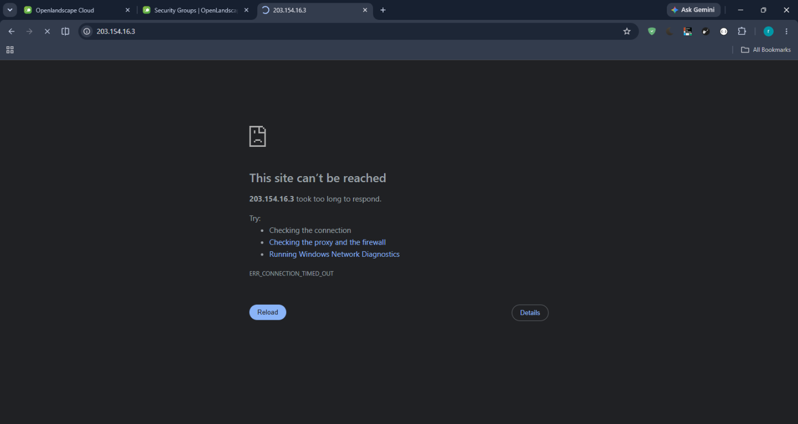
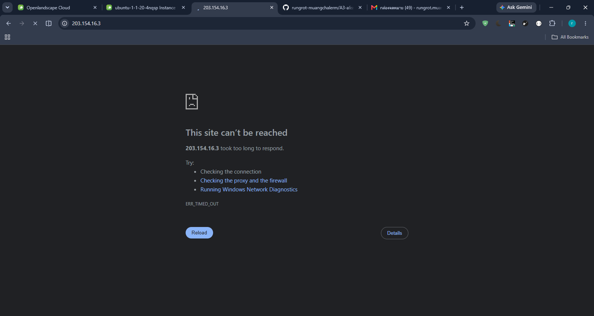
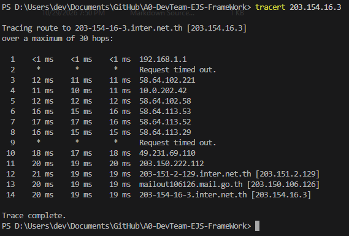
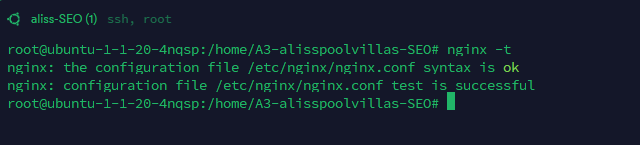
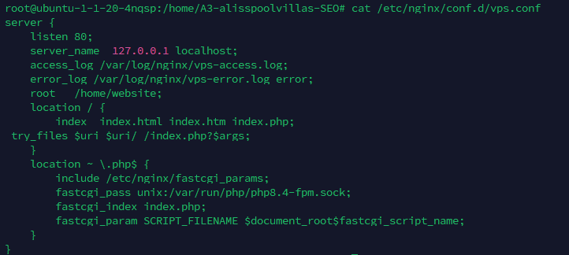
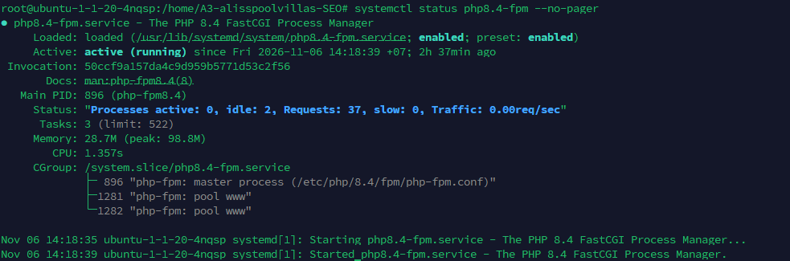
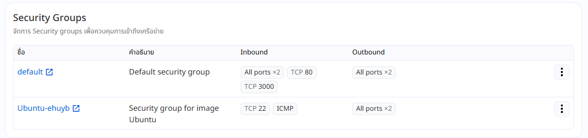
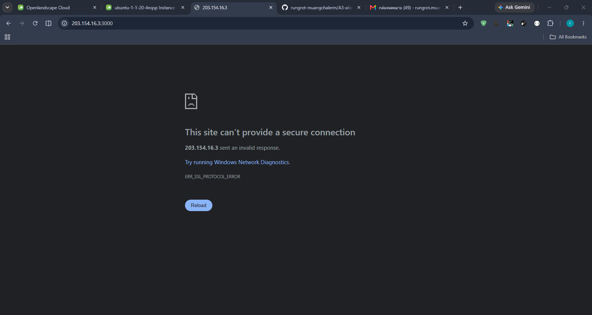
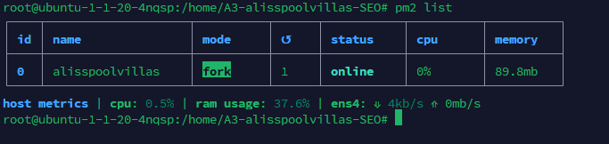
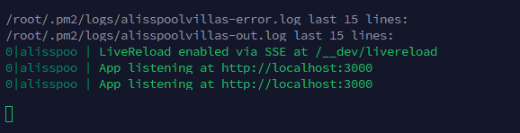

# รายงานปัญหาการเชื่อมต่อเครือข่ายของ VPS

**หัวข้ออีเมล:** ขอให้ตรวจสอบปัญหาการเชื่อมต่อเครือข่ายของ VPS

เรียนทีมงานครับ

รบกวนตรวจสอบเส้นทางเครือข่ายไปยัง Instance ตามข้อมูลด้านล่างครับ

- **Public IP ของ Instance (ต้นทาง):** `203.154.16.3`
- **ปลายทาง:** `203.154.16.3` (HTTP พอร์ต 80 และพอร์ต 3000)
- **ช่วงเวลาที่พบปัญหา:** [ระบุวันที่และเวลาที่พบปัญหา พร้อมเขตเวลา]
- **อาการ:** เข้า `http://203.154.16.3` (พอร์ต 80) แล้วพบ `ERR_CONNECTION_TIMED_OUT`; เมื่อเปิด `203.154.16.3:3000` พบ `ERR_SSL_PROTOCOL_ERROR`

**ข้อสังเกตจากการตรวจสอบฝั่ง Instance**

- Nginx ฟังที่ `0.0.0.0:80` และ `curl` ภายใน Instance ได้ `HTTP 200 OK`
- UFW ไม่ได้เปิดใช้งาน และ Security Group มี Inbound `TCP 80`
- ทดสอบจากภายนอกด้วย `Test-NetConnection` ที่พอร์ต 80 สำเร็จ และ `curl` ได้ `HTTP 200 OK` แต่การเปิดผ่านเบราว์เซอร์ยังพบ timeout
- เมื่อเปิด `203.154.16.3:3000` เบราว์เซอร์รายงาน `ERR_SSL_PROTOCOL_ERROR`
- PM2 log แสดงว่าแอปฟังที่ `http://localhost:3000`
- `tracert` ไปถึง Public IP ปลายทาง แต่มีบาง hop ไม่ตอบกลับ
- Instance อีกเครื่องที่มี Public IP `203.154.16.9` ไม่สามารถเชื่อมต่อออกอินเทอร์เน็ตได้
- กังวลว่า Instance ที่สร้างเพิ่มเติมอาจพบปัญหาด้านเครือข่ายเช่นเดียวกัน

จึงขอให้ช่วยตรวจสอบปัญหาการเชื่อมต่อขาเข้าและขาออกของทั้งสอง Instance รวมถึงตรวจสอบว่าปัญหานี้อาจกระทบ Instance อื่นที่สร้างเพิ่มเติมหรือไม่ ทั้งนี้ได้เปิดพอร์ตที่กำหนดไว้ใน Security Group แล้วครับ

ผลเปิด IP โดยตรงผ่านพอร์ต 80:

ผลทดสอบล่าสุด:

แนบผล `tracert` จากเครื่องต้นทางไปยัง `203.154.16.3` มาพร้อมอีเมลนี้แล้วครับ:

ตรวจสอบ config Nginx แล้วผ่านครับ:

config Nginx ที่ใช้งานอยู่ครับ:

สถานะ PHP-FPM ครับ:

กฎ Security Group ครับ:

ผลเปิดพอร์ต 3000 ในเบราว์เซอร์ครับ:

สถานะ PM2 ของแอปพลิเคชันครับ:

log แสดง address ที่แอปฟังอยู่ครับ:

ขอบคุณครับ
